# SOFA_CloSer

Soft-robotics simulations from the CloSer project, running in the browser.

## [MultiSim](MultiSim/)

**MultiSim** is a web platform that runs physics simulations for many visitors at once. Pick a scene in the lobby
and you get your own live simulation on the server. You see it in 3D in your browser, change its parameters, drive it
with sliders, follow charts as it runs and download the data. Others can watch your simulation while you work.

**Try it live: <https://closer.ram.eemcs.utwente.nl/sofa/>**

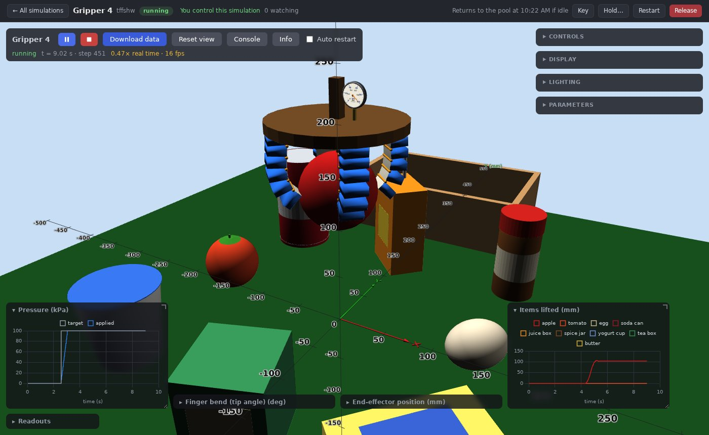

*Gripper 4: steer the end-effector over an item, close the fingers with the pressure slider and lift it. The charts
show the finger pressure and how far each item is lifted.*

### What it offers

- **A simulation of your own**: claim a scene from a shared pool and get a key to take control again from any browser.
  Idle simulations go back to the pool by themselves, and a simulation can be held for a demo later in the day.
- **Watch others**: every running simulation can be opened read-only and explored in 3D.
- **Live 3D view** (three.js) with display and lighting settings, opacity per part, a scale ruler and pressure gauges.
- **Parameters and presets**: change the geometry, material, mesh or loads and restart, or pick a saved preset.
  Runs of presets are recorded once, so they play back instantly with a timeline.
- **Live controls**: sliders for pressure and for moving a gripper's end-effector while the simulation runs.
- **Charts and readouts** (bend angles, forces, volume growth, lifted height) and a CSV download of all data.
- **More than one physics engine**: scenes run on [SOFA](https://www.sofa-framework.org/) with the
  [SoftRobots](https://github.com/SofaDefrost/SoftRobots) plugin, and on [MuJoCo](https://mujoco.org/), so the same
  scenario can be compared on both.
- **The original SOFA scripts still run** in SOFA's own desktop app: MultiSim's runtime (*sofaweb*) wraps an existing
  scene script without changing it.
- **Admin page**: scene visibility (public, private, admin-only), limits, holds, logs and scene builds.
- Works on phones and tablets.

### Recent scenes

| | |
|---|---|
| 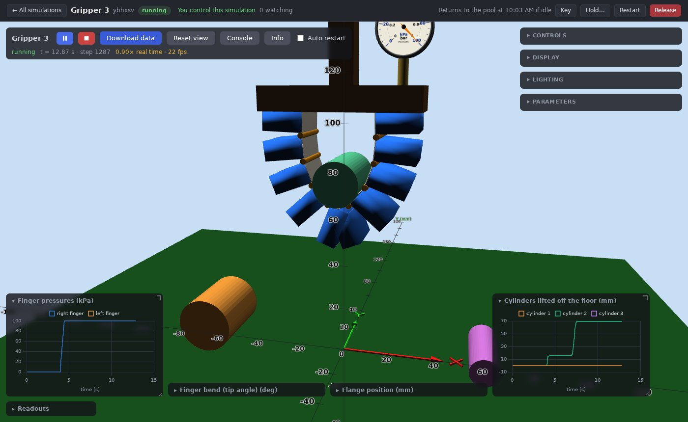 | 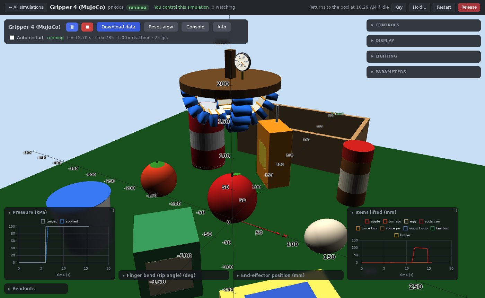 |
| **Gripper 3**: two fingers made of rigid segments and compliant hinges lift a cylinder; faster than real time. | **Gripper 4 (MuJoCo)**: the same gripper, items and moves as Gripper 4, simulated with MuJoCo instead of SOFA. Here the apple slipped out after about 3 s (chart on the right), where SOFA held on. |
| 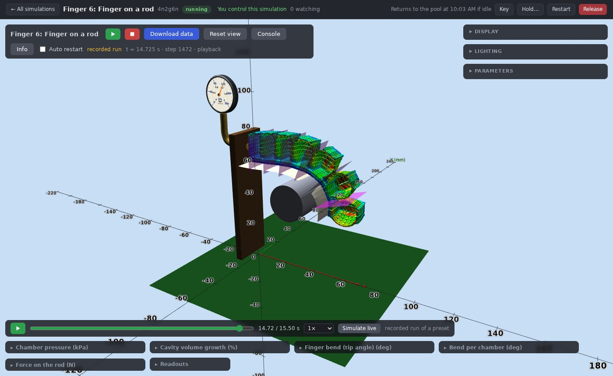 | 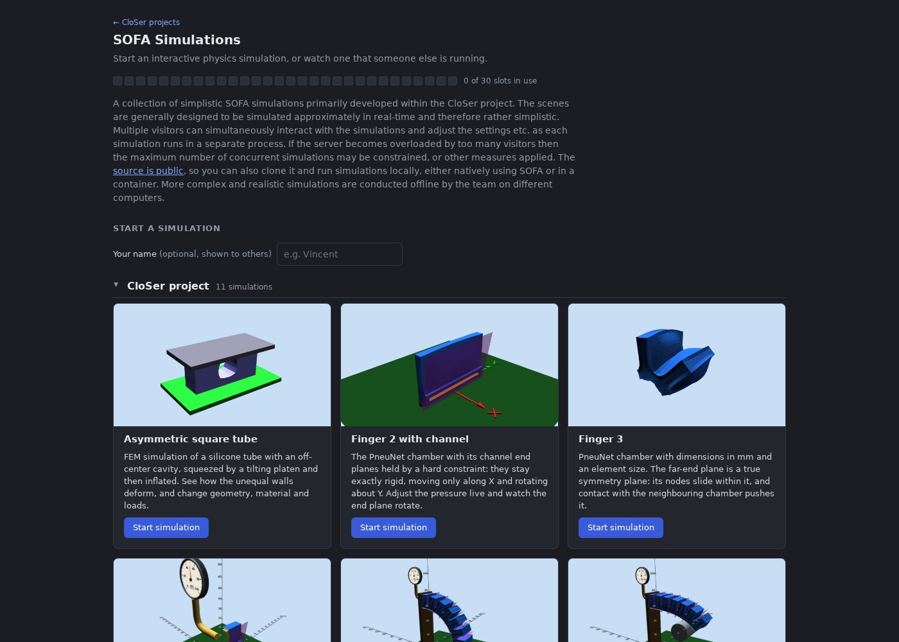 |
| **Finger 6**: a human-scale PneuNet finger (FEM, 7 chambers) inflated around a rod. | **The lobby**: start a simulation, or watch one that someone else is running. |

### All scenes

<table>
<tr><td width="33%" valign="top">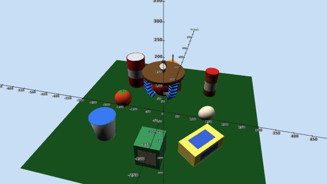<br><b>Gripper 4</b>: a gripper moving in X, Y and Z over grocery items; any number of fingers, friction contacts.</td><td width="33%" valign="top">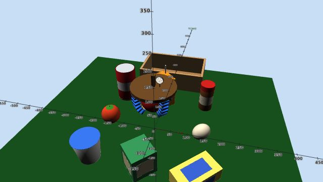<br><b>Gripper 4 (MuJoCo)</b>: the same scene in MuJoCo, several times faster than real time.</td><td width="33%" valign="top">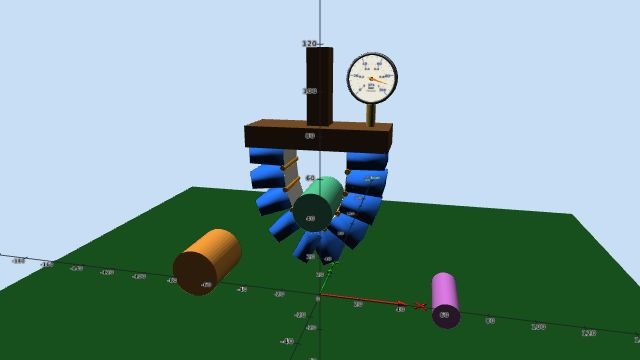<br><b>Gripper 3</b>: Gripper 2 with rigid segments and compliant hinges instead of finite elements.</td></tr>
<tr><td width="33%" valign="top">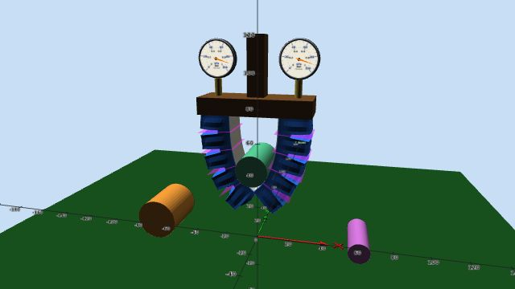<br><b>Gripper 2</b>: two FEM PneuNet fingers on a movable end-effector, with loose cylinders to pick up.</td><td width="33%" valign="top">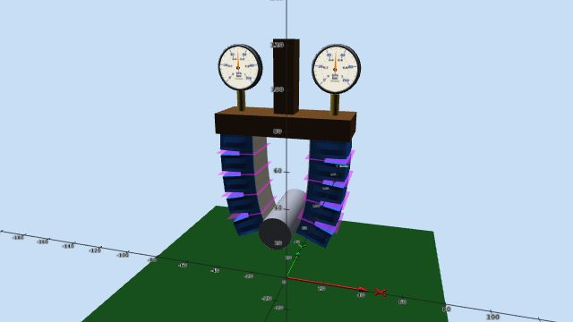<br><b>Gripper 1</b>: two FEM fingers on a fixed end-effector, closing around a rod.</td><td width="33%" valign="top">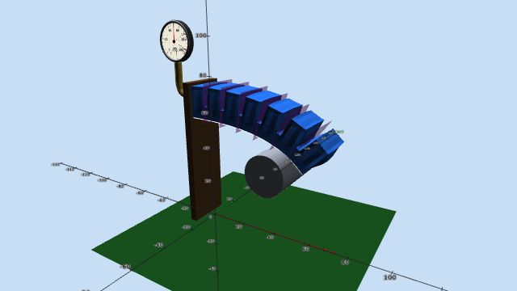<br><b>Finger 6</b>: a human-scale PneuNet finger curling onto a rigid rod.</td></tr>
<tr><td width="33%" valign="top">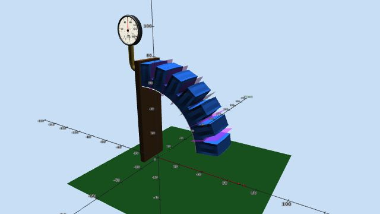<br><b>Finger 5</b>: the full human-scale finger, 7 chambers, collision planes between them.</td><td width="33%" valign="top">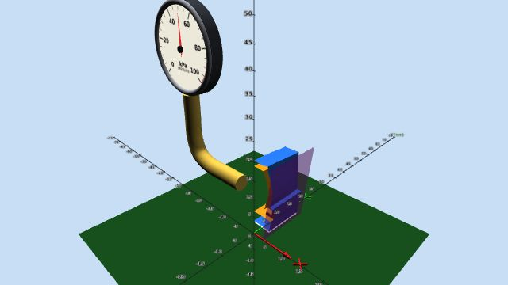<br><b>Finger 4</b>: one index-finger-sized chamber with a strain-limiting layer.</td><td width="33%" valign="top">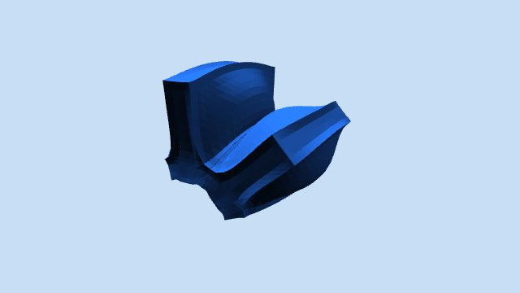<br><b>Finger 3</b>: a PneuNet chamber with a true symmetry plane.</td></tr>
<tr><td width="33%" valign="top">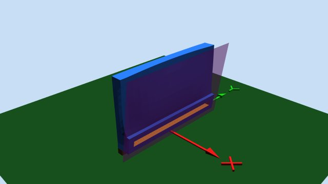<br><b>Finger 2</b>: a PneuNet chamber with rigid channel end planes.</td><td width="33%" valign="top">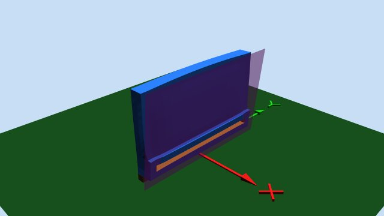<br><b>Finger 1</b>: one chamber of a PneuNet finger, inflated with surface pressure.</td><td width="33%" valign="top">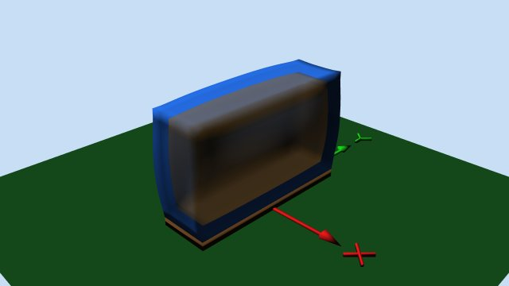<br><b>Hollow cube</b>: a silicone box inflated from inside.</td></tr>
<tr><td width="33%" valign="top">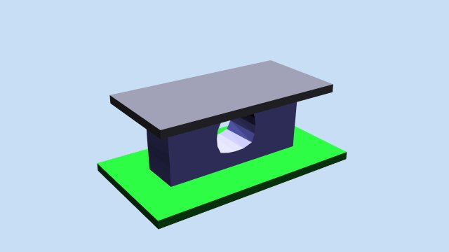<br><b>Asymmetric square tube</b>: a tube with an off-centre cavity, squeezed and inflated.</td><td width="33%" valign="top">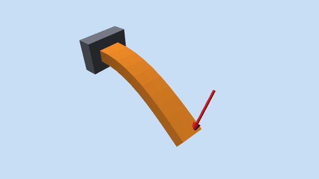<br><b>Soft beam</b>: a clamped silicone beam to push, pull and flick.</td><td width="33%" valign="top">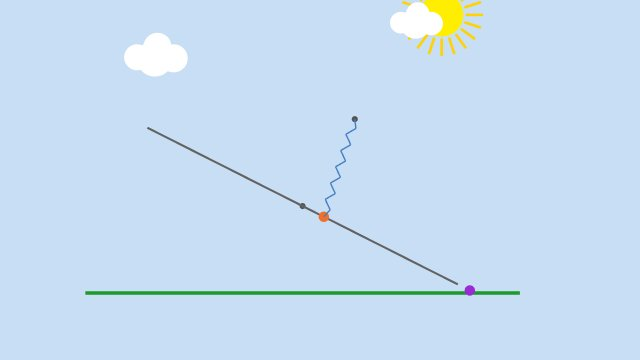<br><b>Rod with sliding balls</b>: a swinging rod with two beads, one on a spring.</td></tr>
<tr><td width="33%" valign="top">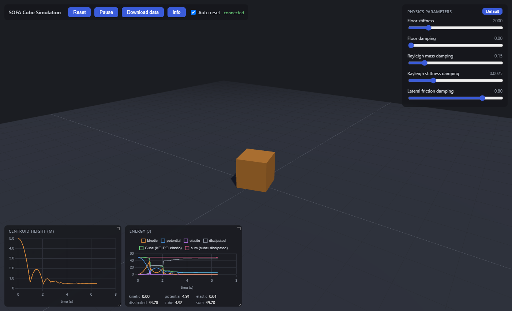<br><b>Falling cube</b>: a rigid cube bouncing on a floor.</td><td width="33%" valign="top">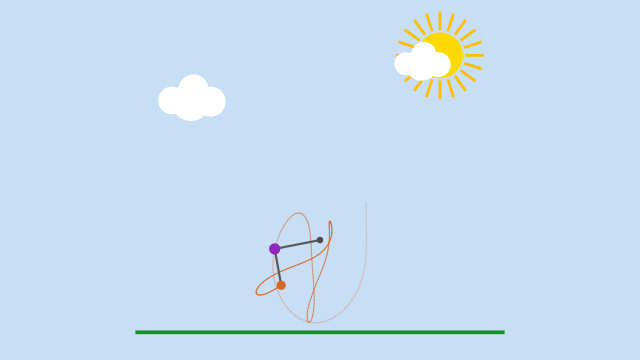<br><b>Double pendulum</b>: a textbook chaotic system.</td></tr>
</table>

### Run it yourself

Simulations run as plain processes (Linux, LXC containers) or as Docker containers:

```bash
cd MultiSim
./run.sh            # Linux, native processes
run-docker.bat      # Docker (or ./run-docker.sh)
```

A single scene also runs in the SOFA desktop app, from its unmodified original script:
`runSofa scenes/<id>/original/<Scene>.py`.
See [MultiSim/README.md](MultiSim/README.md) for the setup, deployment and architecture, and
[MultiSim/scenes/README.md](MultiSim/scenes/README.md) for adding a scene.

## [TestSimInDocker](TestSimInDocker/)

The first experiment that MultiSim grew out of: a rigid cube falls under gravity, bounces and settles on a floor,
simulated headlessly by SOFA and streamed live to a browser that renders it with three.js and plots its energy over
time. Ships as a single Docker image.


```bash
cd TestSimInDocker
run_docker.bat
```

See [TestSimInDocker/README.md](TestSimInDocker/README.md) for details.

## License

MIT (see [LICENSE](LICENSE)), for the code and scenes in this repository.

The simulations run on software that is not part of this repository and keeps its own license:
[SOFA](https://www.sofa-framework.org/) (LGPL-2.1) with the
[SoftRobots](https://github.com/SofaDefrost/SoftRobots) plugin (LGPL-3.0), and
[MuJoCo](https://github.com/google-deepmind/mujoco) (Apache-2.0); the Dockerfiles download SOFA, they don't contain it.
The pages load [three.js](https://threejs.org/) and [Chart.js](https://www.chartjs.org/) (both MIT) from a CDN.
A Docker image built from this repository contains SOFA and SoftRobots, so sharing such an image means passing on
their licenses (LGPL) as well.

## AI disclaimer

Claude Code was used to generate the whole simulation and most documentation.
